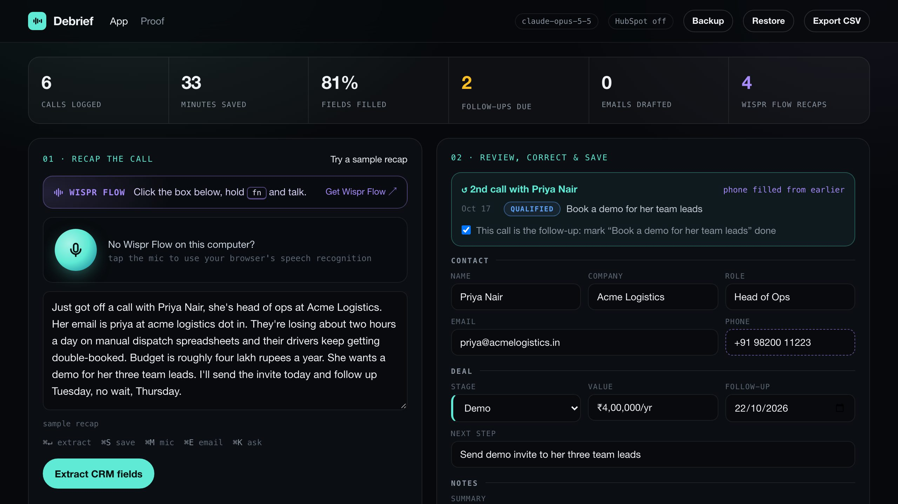
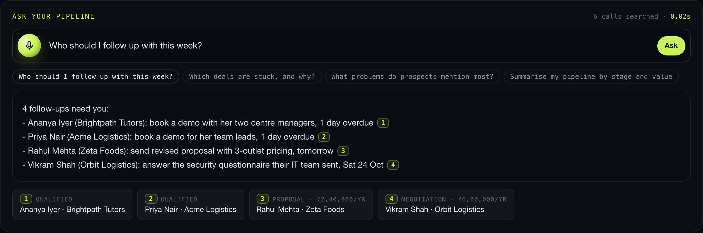
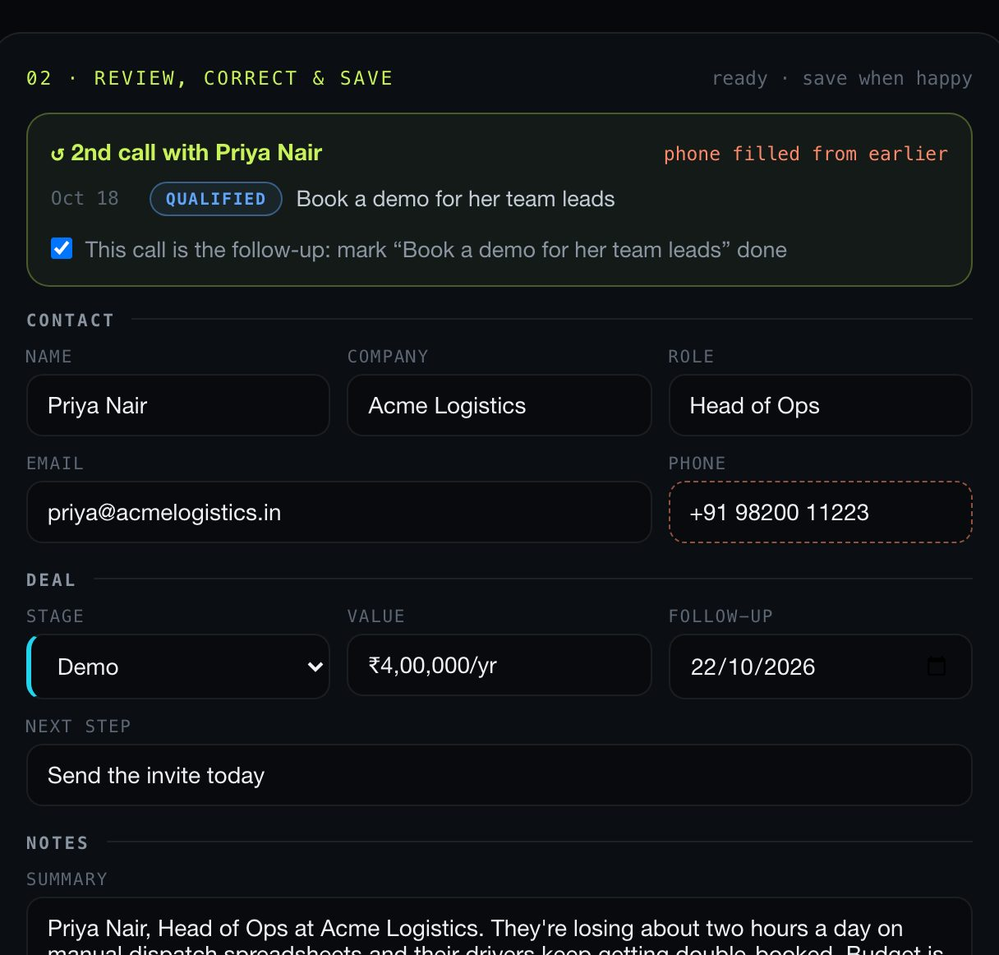
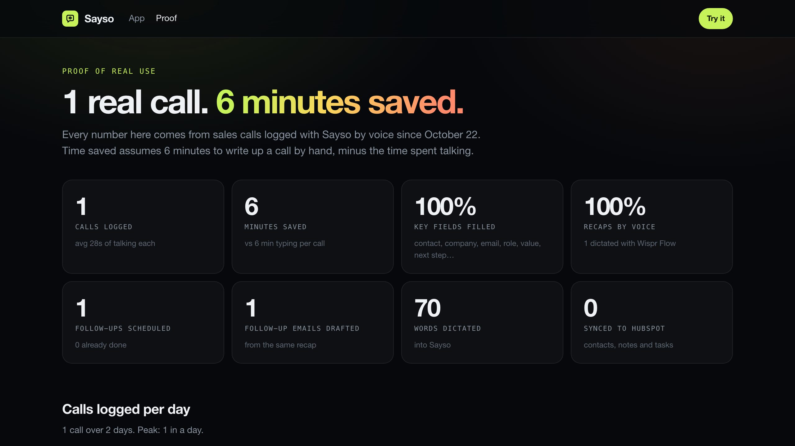
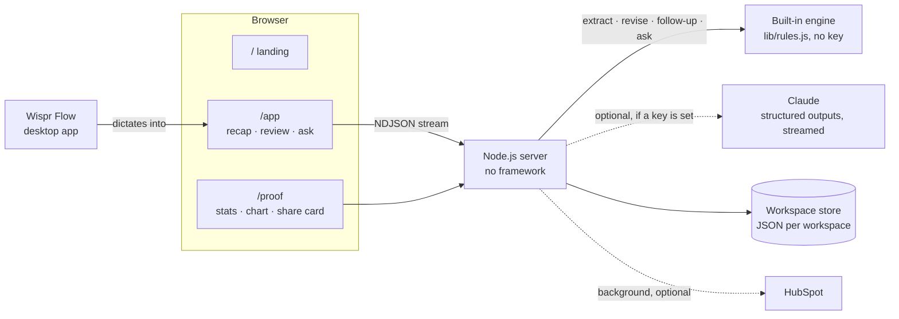

<div align="center">


# Sayso

**Talk for 30 seconds. Your CRM updates itself.**

A voice-first CRM for sales calls. Dictate a recap with Wispr Flow and Sayso fills in a complete CRM record,<br>
fixes it by voice, drafts the follow-up email, and answers questions about your pipeline with citations.


**WeMakeDevs × Wispr Flow · No Hands: The Wispr Challenge · Builders track**

[For judges](#for-judges) · [The solution](#the-solution) · [Features](#features) · [How Wispr Flow is used](#how-wispr-flow-is-used) · [Architecture](#architecture) · [Key prompts](#key-prompts) · [Getting started](#getting-started)

</div>

<!-- TODO: add the demo video link once published -->



## For judges

**Watch:** demo video (1:35, 1080p): _add YouTube link_ · [60-second product tour](public/media/sayso-tour.webm) (captioned, recorded from the app on sample data).

**Try it live:** **https://sayso-xi.vercel.app**. No sign-in: every visitor gets a private workspace with 6 sample calls. Suggested path:
1. **Try a sample recap** and watch the record fill in. It's a second call with Priya, so you'll see her history and her phone number carried over.
2. In the correction bar, say or type **"change the stage to proposal"**, then **"write the follow-up"**, then **"save"**.
3. In **Ask your pipeline**, click **"Who should I follow up with this week?"** and click a citation.
4. Open **Proof** to see real usage numbers from the author's own calls.
5. **Reset to sample data** puts the workspace back to a known state.

**Run it yourself, no API key needed:**
```bash
npm install && npm run demo     # http://localhost:3000, sample data, built-in engine
```

---

## The problem

After a sales call, the CRM is supposed to be updated. It usually isn't:

- Writing up a call takes about 6 minutes, often longer than the call itself, so it gets skipped.
- Records end up half-empty: no email, no deal value, no next step. Pipeline reviews become guesswork.
- "I'll send it Thursday" lives in someone's head until it doesn't, and deals go cold quietly.
- Tools that need typing into five fields between meetings don't get used.

## The solution

Sayso replaces the form with your voice. You talk; it writes the record.

| Say | Get |
|---|---|
| *"Just got off with Priya Nair, head of ops at Acme Logistics. Email is priya at acme logistics dot in. Budget's around four lakh a year. Follow up Tuesday, no wait, Thursday."* | A complete record: **Priya Nair · Head of Ops · Acme Logistics · priya@acmelogistics.in · ₹4,00,000/yr · Demo**, follow-up on **Thursday's date**. The self-correction and the spoken email are handled. |
| *"The value is five lakh."* | Only the deal value changes. Everything else stays exactly as it was. |
| *"Write the follow-up."* | A short, specific email drafted from the same call, ready to copy or open in your mail app. |
| *"Who should I follow up with this week?"* | A direct answer with numbered citations that jump to the calls it came from. |
| *A second call with Priya, without repeating her details* | **"↺ 2nd call with Priya Nair"**: phone and email carried over from the intro call, and the intro call's follow-up marked done. |



## Features

**Capture**
- **Wispr Flow first.** The recap box shows your Wispr Flow shortcut (fn on Mac, Ctrl + Win on Windows) and confirms when dictation arrives. The browser's speech recognition is the fallback.
- **No API key needed.** The built-in engine fills the record in milliseconds and runs entirely on your server. Add an Anthropic key and Claude takes over, streaming fields as it writes them. Extraction starts on its own when you stop the mic.
- **Nothing invented.** Fields you didn't mention stay blank; names, emails, amounts and dates are never guessed.

**Hands-free review**
- **Voice corrections** change only the field you name.
- **Voice commands:** "save", "discard", "write the follow-up".
- **A floating action bar** keeps the correction input and Save in view while you review.

**Pipeline**
- **Contact history.** A recap about someone you've spoken to before shows "2nd call with Priya", fills in details you didn't repeat (email, phone, company, role) from the last call, and offers to mark the earlier follow-up done, since this call *is* that follow-up.
- **Edit any saved call**, and **back up / restore** the whole call log as one JSON file.
- **Ask your pipeline:** answers come only from your call log, with citations, and say so when the answer isn't there.
- **Follow-ups due** in the next 3 days stay pinned until marked done.
- **Proof page:** calls logged, minutes saved, fields filled, Wispr Flow recaps, a per-day chart and a share card.
- **CSV export** (spreadsheet-formula safe) and optional **HubSpot sync** (contact, call note, follow-up task).

| Hands-free correction and follow-up email | Proof of real use |
|---|---|
|  |  |

## Challenge alignment

| Judging question | How Sayso answers it |
|---|---|
| Does it solve a real problem in your work? | Built for the author's own post-call admin; `/proof` shows real calls, minutes saved and field completeness. |
| Was Wispr used meaningfully? | Built by dictating to an AI coding tool with Wispr Flow, and Wispr Flow is the product's main input (see below). |
| Does it work? | A live link that opens without sign-in, with a private sample workspace per visitor and usage caps. |
| Is the demo clear? | A 1:35 captioned 1080p demo video plus a 60-second tour, both recorded straight from the app by script (`npm run record:demo`). |

## How Wispr Flow is used

| Where | How |
|---|---|
| **Building it** | Every prompt to the AI coding tool, the README, commit messages and progress posts were dictated with Wispr Flow. |
| **Recap box** | Shows the Wispr Flow shortcut for your OS and lights up with "✓ Dictation detected" when Wispr Flow text arrives. |
| **Detection** | Wispr Flow inserts whole phrases at once, while typing inserts one character at a time. Sayso tags recaps "dictated with Wispr Flow" on that signal. |
| **Corrections and Ask** | Plain text fields, so Wispr Flow works in them like any other app. |
| **Measurement** | The stats bar and `/proof` count Wispr Flow recaps and the share of recaps given by voice. |

## Architecture



- **Two engines:** the built-in engine (`lib/rules.js`) needs no key. With `ANTHROPIC_API_KEY` set, Claude is used instead, and if a Claude call fails the built-in engine answers, so the app never breaks. Claude's JSON is parsed while it streams (`lib/partial-json.js`), so each field appears as soon as it's written. The browser cancels the request if you leave.
- **Store:** each workspace is held in memory and written to disk in order (temp file + rename), so saves are instant and a crash can't corrupt the file.
- **Public demo mode** (`PUBLIC_MODE=1`): private sample workspace per visitor, daily request caps per workspace, network and site, HubSpot off, `/proof` served from a committed snapshot.

**Tech stack:** Node.js 22 (no framework) · built-in rules engine · optional Anthropic Claude (`claude-opus-5-5`) · vanilla HTML/CSS/JS · Playwright (video recording, dev only).

## Built-in engine (no API key)

`lib/rules.js` reads a dictated recap the way a salesperson says it:

| Said | Understood as |
|---|---|
| "priya dot n at acme logistics dot co dot in" | `priya.n@acmelogistics.co.in` |
| "nine eight seven six five, four three two one zero" | `+91 98765 43210` |
| "about two point four lakh a year" · "$24k per month" | `₹2,40,000/yr` · `$24,000/mo` |
| "follow up Tuesday, no wait, Thursday" | Thursday's date (the correction wins) |
| "VP of Sales at Northwind" | role `VP of Sales`, company `Northwind` |
| "legal is reviewing the contract" · "they signed" | stage `negotiation` · `won` |
| "the value is five lakh and the stage is proposal" | changes exactly those two fields |
| "who should I follow up with this week?" | due follow-ups, newest call per contact, each cited |

It also drafts the follow-up email from the record and answers questions about stuck deals, common problems, the pipeline by stage and value, or any contact by name. `test/rules.test.js` pins this down on realistic recaps.

## Key prompts (optional Claude mode)

These are the product's core logic, from `lib/extract.js`. Every task uses a JSON schema (structured outputs), so the model can only return the expected fields.

**Extract a record from a dictated recap:**
```text
You turn a salesperson's spoken post-call recap into a CRM record.
The recap is dictated, so expect filler words, self-corrections ("no wait, Thursday") and spelled-out emails
("priya at acme dot com"). Use the corrected version and normalise emails and phone numbers.
Only record what the speaker said. If a field was not mentioned, return "" (or [] for lists); never guess names,
emails, amounts or dates.
```

**Apply a spoken correction:**
```text
Return the full record with only the requested changes applied; keep every other field exactly as it was.
```

**Answer a question with citations:**
```text
Cite every call you rely on inline as [C<n>] and list those ids in "sources". If the log doesn't contain
the answer, say so plainly instead of guessing.
```
Calls are numbered `C1…Cn` in the prompt; the server maps cited ids back to real calls before the browser renders them as numbered footnotes.

## Getting started

```bash
npm install
npm run demo          # sample data in a separate workspace
npm start             # http://localhost:3000, your real call log
# optional: cp .env.example .env and add ANTHROPIC_API_KEY to use Claude
npm run doctor        # checks your setup and prints the fix for anything wrong
```

### Deploy on Vercel (static, free)
The online demo needs no server: `npm run build:static` builds `dist/`, where `public/static-api.js` answers the app's `/api` calls in the browser with the built-in engine, and each visitor's calls stay in their own browser (seeded with the sample calls).
1. On [Vercel](https://vercel.com/new): **Import** this GitHub repo. `vercel.json` sets the build; no settings or keys needed.
2. To show your real results on `/proof`: on your local copy open `/proof` → **Publish proof snapshot**, commit `data/proof.json`, push. Vercel redeploys.

### Deploy the full server (Render, free)
For HubSpot sync and optional Claude: on [Render](https://dashboard.render.com) choose **New → Blueprint** and pick this repo (`render.yaml` is included). No keys needed.

### Configuration

| Variable | Purpose | Default |
|---|---|---|
| `ANTHROPIC_API_KEY` | Use Claude instead of the built-in engine | optional |
| `CLAUDE_MODEL` | Model id | `claude-opus-5-5` |
| `HUBSPOT_TOKEN` | Optional HubSpot private-app token | off |
| `PUBLIC_MODE` | `1` for the hosted demo | off |
| `LIMIT_PER_WORKSPACE` / `LIMIT_PER_IP` / `LIMIT_GLOBAL` | Daily request caps in public mode | 40 / 80 / 1,500 |
| `MANUAL_WRITEUP_MINUTES` | Minutes a manual write-up takes, for "minutes saved" | 6 |
| `PUBLIC_URL` | Site address for link previews (Render sets it automatically) | from host |

## Quality and testing

| Check | Result |
|---|---|
| Automated tests (`npm test`) | **34 passing**: the built-in engine on realistic recaps (lakh/crore/dollar amounts, spoken emails and phone numbers, "no wait" corrections, stages, departments vs companies), streaming extraction, corrections, follow-up emails, cited answers, workspace isolation, usage caps, reset rules, backup/restore, proof privacy scrubbing, CSV formula safety, partial-JSON parsing, page caching, and recovery when the API rejects the refusal-fallback beta. Runs the real server against a mocked Claude, so no key is needed. |
| Judge walkthrough | Every step a judge takes (landing → tour → app → recap → correction → email → save → ask → export → proof → reset) passes on desktop and phone with no page errors, failed requests or sideways scrolling. |
| Speed | Landing page is 14 KB gzipped and served from memory; fields stream as they're written; saves are optimistic. |
| Production install | One runtime dependency (`@anthropic-ai/sdk`, only used if a key is set). Works fully offline with the built-in engine. |

## Security and privacy

- Every value rendered in the page is HTML-escaped; record edits are limited to an allow-list of fields.
- Public visitors get isolated workspaces (HTTP-only cookie); requests are rate-limited and inputs size-capped.
- `/proof` shows only aggregates and calls the owner chooses to feature; contact names are shortened and emails and phone numbers are scrubbed from the text.
- CSV exports neutralise spreadsheet formulas; pages can't be embedded in other sites.

## Project structure

| Path | Description |
|---|---|
| `server.js` | HTTP server: pages, streaming routes, workspaces, public-mode rules |
| `lib/rules.js` | Built-in engine: extraction, corrections, follow-up emails and pipeline answers without an API key |
| `lib/extract.js` · `lib/claude.js` | Engine switch, Claude prompts and schemas · streaming structured-output helper |
| `lib/partial-json.js` | Parses incomplete JSON while it streams |
| `lib/store.js` · `lib/proof.js` | Workspace store and CSV · stats, proof data, scrubbing |
| `lib/hubspot.js` · `lib/limits.js` · `lib/samples.js` | HubSpot sync · usage caps · sample calls |
| `public/` | Landing page, app, proof page, `static-api.js` (in-browser API for the static build) and `media/` |
| `scripts/` | Demo mode, static build, Claude mock (tests), video recorders, doctor |
| `test/` | Unit and end-to-end tests |

## Limitations and roadmap

| Today | Next |
|---|---|
| Dictation detection is a heuristic, so pasted text also counts as dictated. | A confirmation toggle per recap. |
| HubSpot sync follows HubSpot's v3 API but hasn't been tested against a live account. | Verify with a real portal; add Zoho and Salesforce. |
| Data is a JSON file per workspace, and Render's free disk resets on redeploy. | A hosted database for multi-user teams. |
| No sign-in: the local app is single-user, and demo workspaces are tied to a browser cookie. | Accounts and shared team workspaces. |
| Rate limits are in memory, per server instance. | Shared limits. |

## AI assistance disclosure

This project was built with an AI coding assistant, **Anthropic's Claude (via Claude Code)**, directed by voice through **Wispr Flow**, as the challenge intends. It helped tests, UI and documentation. I chose the problem, directed the product and design decisions, and reviewed and tested the result.

## Credits

Built for **No Hands: The Wispr Challenge** (WeMakeDevs × Wispr Flow) by **Utkarsh Sonthalia**.
Dictation by [Wispr Flow](https://wisprflow.ai). Optional AI by [Anthropic Claude](https://www.anthropic.com). All people and companies in the sample data are fictional.
