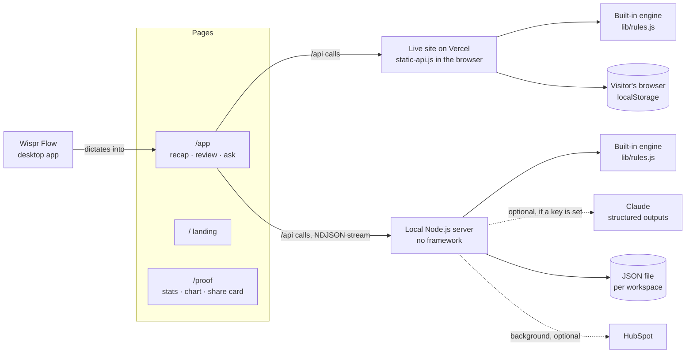

<div align="center">


# Sayso

**Talk for 30 seconds. Your CRM updates itself.**

A voice-first CRM for sales calls. Dictate a recap with Wispr Flow and Sayso fills in a complete CRM record,<br>
fixes it by voice, drafts the follow-up email, and answers questions about your pipeline with citations.


**WeMakeDevs × Wispr Flow · No Hands: The Wispr Challenge · Builders track**

[Live site](https://sayso-xi.vercel.app) · [For judges](#for-judges) · [The solution](#the-solution) · [Features](#features) · [How Wispr Flow is used](#how-wispr-flow-is-used) · [Architecture](#architecture) · [Built-in engine](#built-in-engine-no-api-key) · [Getting started](#getting-started)

</div>


## For judges

**Watch:** [30-second product tour](public/media/sayso-tour.webm), captioned and recorded straight from the app.

**Try it live:** **https://sayso-xi.vercel.app** → **Open app**. No sign-in, no API key. A pop-up asks how to start: **Open the demo** (6 example calls) or **Set up my company** (an empty workspace with your company name, your name, what you sell and your currency). Suggested path with the demo (about 2 minutes):
1. Click **Try an example** and watch the record fill in. It's a second call with Priya, so you'll see her history and her phone number carried over.
2. In the correction bar, say or type **"change the stage to proposal"**, then **"write the follow-up"**, then **"save"**.
3. In **Ask your pipeline**, click **"Who should I follow up with this week?"**, then click a citation to jump to the call.
4. With [Wispr Flow](https://wisprflow.ai) installed: click the recap box, hold **fn** and talk through a call of your own. Release, pause, and it extracts by itself.
5. Open **Proof**: the page that tracks real use of Sayso (calls logged, minutes saved, fields filled, Wispr Flow recaps), with a per-day chart and a share card.

**Run it yourself, no API key needed:**
```bash
npm install && npm run try      # http://localhost:3000, example calls, built-in engine
```

---

## The problem

After a sales call, the CRM is supposed to be updated. It usually isn't:

- Writing up a call takes about 6 minutes, often longer than the call itself, so it gets skipped.
- Records end up half-empty: no email, no deal value, no next step. Pipeline reviews become guesswork.
- "I'll send it Thursday" lives in someone's head until it doesn't, and deals go cold quietly.
- Tools that need typing into five fields between meetings don't get used.

## The solution

Sayso replaces the form with your voice. You talk; it writes the record.

| Say | Get |
|---|---|
| *"Just got off with Priya Nair, head of ops at Acme Logistics. Email is priya at acme logistics dot in. Budget's around four lakh a year. Follow up Tuesday, no wait, Thursday."* | A complete record: **Priya Nair · Head of Ops · Acme Logistics · priya@acmelogistics.in · ₹4,00,000/yr · Demo**, follow-up on **Thursday's date**. The self-correction and the spoken email are handled. |
| *"The value is five lakh."* | Only the deal value changes. Everything else stays exactly as it was. |
| *"Write the follow-up."* | A short, specific email drafted from the same call, ready to copy or open in your mail app. |
| *"Who should I follow up with this week?"* | A direct answer with numbered citations that jump to the calls it came from. |
| *A second call with Priya, without repeating her details* | **"↺ 2nd call with Priya Nair"**: phone and email carried over from the intro call, and the intro call's follow-up marked done. |


## Features

**Capture**
- **Wispr Flow first.** The recap box shows your Wispr Flow shortcut (fn on Mac, Ctrl + Win on Windows) and confirms when dictation arrives. The browser's speech recognition is the fallback.
- **No API key needed.** The built-in engine fills the record in milliseconds, in the browser on the live site or on your own machine. Add an Anthropic key to the local server and Claude takes over, streaming fields as it writes them.
- **Hands-free.** Extraction starts on its own 2 seconds after Wispr Flow dictation stops (or when you stop the mic); dictated corrections and questions run by themselves too.
- **Nothing invented.** Fields you didn't mention stay blank; names, emails, amounts and dates are never guessed.

**Hands-free review**
- **Voice corrections** change only the field you name.
- **Voice commands:** "save", "discard", "write the follow-up".
- **A floating action bar** keeps the correction input and Save in view while you review.

**Your company, or the demo**
- **First-visit choice.** Set up your company (company name, your name, what you sell, currency) to log your own calls, or explore the demo's example calls. Once set up, **Open app** goes straight to your calls; the workspace button in the header edits your details or switches to the demo.
- **Your details are used.** Follow-up emails are signed with your name and company and mention what you sell; amounts without a currency use yours ("forty thousand a year" → `$40,000/yr`), while "four lakh" stays in rupees.
- **Safe on your own copy.** Locally, Sayso only offers company setup, so example calls can never replace your real call log.

**Pipeline**
- **Contact history.** A recap about someone you've spoken to before shows "2nd call with Priya", fills in details you didn't repeat (email, phone, company, role) from the last call, and offers to mark the earlier follow-up done, since this call *is* that follow-up.
- **Edit any saved call**, and **back up / restore** the whole call log as one JSON file.
- **Ask your pipeline:** answers come only from your call log, with citations, and say so when the answer isn't there.
- **Follow-ups due** in the next 3 days stay pinned until marked done.
- **Proof page:** calls logged, minutes saved, fields filled, Wispr Flow recaps, a per-day chart and a share card.
- **CSV export** (spreadsheet-formula safe) and optional **HubSpot sync** (contact, call note, follow-up task).

| Hands-free correction and follow-up email | Proof of real use |
|---|---|
|  |  |

## Challenge alignment

| Judging question | How Sayso answers it |
|---|---|
| Does it solve a real problem in your work? | Built for the author's own post-call admin. `/proof` tracks real use: calls logged, minutes saved, field completeness and Wispr Flow recaps. |
| Was Wispr used meaningfully? | Built by dictating to an AI coding tool with Wispr Flow, and Wispr Flow is the product's main input (see below). |
| Does it work? | A live link that opens without sign-in or an API key. A pop-up offers **Open the demo** (6 example calls) or **Set up my company**, and each visitor's workspace is private to their browser. |
| Is the video clear? | A captioned 1080p walkthrough video (linked in the submission) and the 30-second tour above, both recorded straight from the app by script (`npm run record:video`, `npm run record:tour`). |

## How Wispr Flow is used

| Where | How |
|---|---|
| **Building it** | Every prompt to the AI coding tool, the README, commit messages and progress posts were dictated with Wispr Flow. |
| **Recap box** | Shows the Wispr Flow shortcut for your OS (fn on Mac, Ctrl + Win on Windows) and lights up with "✓ Dictation detected" when Wispr Flow text arrives. |
| **Detection** | Wispr Flow inserts whole phrases at once (as a paste, one long insert, or text set through macOS accessibility), while typing adds a character at a time. Sayso measures how much text arrives per change and tags recaps "dictated with Wispr Flow". |
| **Hands-free** | After a dictated recap, Sayso extracts by itself after a 2-second pause, with a visible countdown. Dictated corrections ("stage is proposal", "save") and Ask questions run about a second after you stop. |
| **Measurement** | The stats bar and `/proof` count Wispr Flow recaps and the share of recaps given by voice. |

## Architecture

Sayso runs two ways from the same pages and the same engine:



- **Live site (Vercel):** static files only. `public/static-api.js` answers the pages' `/api` calls inside the browser with the built-in engine, and each visitor's calls stay in their own browser, so nothing is shared and nothing can break server-side.
- **Local server (`npm start`):** your real call log on disk, optional Claude and HubSpot, and the proof snapshot you publish.
- **Two engines:** the built-in engine (`lib/rules.js`) needs no key. With `ANTHROPIC_API_KEY` set, Claude is used instead, and if a Claude call fails the built-in engine answers, so the app never breaks. Claude's JSON is parsed while it streams (`lib/partial-json.js`), so each field appears as soon as it's written. The browser cancels the request if you leave.
- **Store:** each workspace is held in memory and written to disk in order (temp file + rename), so saves are instant and a crash can't corrupt the file.
- **Public server mode** (`PUBLIC_MODE=1`, for hosting the full server): private workspace per visitor with the same company-or-demo pop-up, daily request caps per workspace, network and site, HubSpot off, `/proof` served from a committed snapshot.

**Tech stack:** Node.js 22 (no framework) · built-in rules engine · optional Anthropic Claude (`claude-opus-5-5`) · vanilla HTML/CSS/JS · Playwright (video recording, dev only).

## Built-in engine (no API key)

`lib/rules.js` reads a dictated recap the way a salesperson says it:

| Said | Understood as |
|---|---|
| "priya dot n at acme logistics dot co dot in" | `priya.n@acmelogistics.co.in` |
| "nine eight seven six five, four three two one zero" | `+91 98765 43210` |
| "about two point four lakh a year" · "$24k per month" | `₹2,40,000/yr` · `$24,000/mo` |
| "follow up Tuesday, no wait, Thursday" | Thursday's date (the correction wins) |
| "VP of Sales at Northwind" | role `VP of Sales`, company `Northwind` |
| "legal is reviewing the contract" · "they signed" | stage `negotiation` · `won` |
| "the value is five lakh and the stage is proposal" | changes exactly those two fields |
| "who should I follow up with this week?" | due follow-ups, newest call per contact, each cited |

It also drafts the follow-up email from the record and answers questions about stuck deals, common problems, the pipeline by stage and value, or any contact by name. `test/rules.test.js` pins this down on realistic recaps.

## Key prompts (optional Claude mode)

These are the product's core logic, from `lib/extract.js`. Every task uses a JSON schema (structured outputs), so the model can only return the expected fields.

**Extract a record from a dictated recap:**
```text
You turn a salesperson's spoken post-call recap into a CRM record.
The recap is dictated, so expect filler words, self-corrections ("no wait, Thursday") and spelled-out emails
("priya at acme dot com"). Use the corrected version and normalise emails and phone numbers.
Only record what the speaker said. If a field was not mentioned, return "" (or [] for lists); never guess names,
emails, amounts or dates.
```

**Apply a spoken correction:**
```text
Return the full record with only the requested changes applied; keep every other field exactly as it was.
```

**Answer a question with citations:**
```text
Cite every call you rely on inline as [C<n>] and list those ids in "sources". If the log doesn't contain
the answer, say so plainly instead of guessing.
```
Calls are numbered `C1…Cn` in the prompt; the server maps cited ids back to real calls before the browser renders them as numbered footnotes.

## Getting started

```bash
npm install
npm run try           # example calls in a separate workspace
npm start             # http://localhost:3000, your real call log
# optional: cp .env.example .env and add ANTHROPIC_API_KEY to use Claude
npm run doctor        # checks your setup and prints the fix for anything wrong
```

### Deploy on Vercel (static, free)
The live site needs no server: `npm run build:static` builds `dist/`, where `public/static-api.js` answers the app's `/api` calls in the browser with the built-in engine, and each visitor's company details and calls stay in their own browser (the pop-up offers company setup or the demo).
1. On [Vercel](https://vercel.com/new): **Import** this GitHub repo. `vercel.json` sets the build; no settings or keys needed.
2. To show your real results on `/proof`: on your local copy open `/proof` → **Publish proof snapshot**, commit `data/proof.json`, push. Vercel redeploys.

### Deploy the full server (Render, free)
For HubSpot sync and optional Claude: on [Render](https://dashboard.render.com) choose **New → Blueprint** and pick this repo (`render.yaml` is included). No keys needed.

### Configuration

| Variable | Purpose | Default |
|---|---|---|
| `ANTHROPIC_API_KEY` | Use Claude instead of the built-in engine | optional |
| `CLAUDE_MODEL` | Model id | `claude-opus-5-5` |
| `HUBSPOT_TOKEN` | Optional HubSpot private-app token | off |
| `PUBLIC_MODE` | `1` for a public site (a private workspace per visitor) | off |
| `LIMIT_PER_WORKSPACE` / `LIMIT_PER_IP` / `LIMIT_GLOBAL` | Daily request caps in public mode | 40 / 80 / 1,500 |
| `MANUAL_WRITEUP_MINUTES` | Minutes a manual write-up takes, for "minutes saved" | 6 |
| `PUBLIC_URL` | Site address for link previews (Vercel and Render set it automatically) | from host |

## Quality and testing

| Check | Result |
|---|---|
| Automated tests (`npm test`) | **37 passing**: company setup vs demo, currency defaults and sign-off, the built-in engine on realistic recaps (lakh/crore/dollar amounts, spoken emails and phone numbers, "no wait" corrections, stages, departments vs companies), streaming extraction, corrections, follow-up emails, cited answers, workspace isolation, usage caps, reset rules, backup/restore, proof privacy scrubbing, CSV formula safety, partial-JSON parsing, page caching, and recovery when the API rejects the refusal-fallback beta. Runs the real server against a mocked Claude, so no key is needed. |
| Judge walkthrough | Run against the live site in a fresh, signed-out browser: landing → tour video → app → pop-up → **Open the demo** → example recap → correction → follow-up email → save → reload (calls kept) → Ask with citations → CSV and backup downloads → proof. Passes on desktop and phone with no page errors, failed requests or sideways scrolling. |
| Wispr Flow input | Dictation inserted as a paste, a long insert or text set through accessibility is detected and auto-extracted; typing by hand is not. |
| Company setup | On the live site: **Set up my company** with `$` starts an empty workspace, "forty thousand a year" becomes `$40,000/yr`, emails are signed with the name and company, and the workspace button switches to the demo and back. |
| Speed | The built-in engine fills a record in about 0.03 s; saves are instant; pages are single files with no framework, served from Vercel's CDN. |
| Production install | One runtime dependency (`@anthropic-ai/sdk`, only used if a key is set). Works fully offline with the built-in engine. |

## Security and privacy

- Every value rendered in the page is HTML-escaped; record edits are limited to an allow-list of fields.
- On the live site each visitor's calls stay in their own browser; on a public server, visitors get isolated workspaces (HTTP-only cookie), with rate limits and size caps.
- `/proof` shows only aggregates and calls the owner chooses to feature; contact names are shortened and emails and phone numbers are scrubbed from the text.
- CSV exports neutralise spreadsheet formulas; pages can't be embedded in other sites.

## Project structure

| Path | Description |
|---|---|
| `server.js` | HTTP server: pages, streaming routes, workspaces, public-mode rules |
| `lib/rules.js` | Built-in engine: extraction, corrections, follow-up emails and pipeline answers without an API key |
| `lib/extract.js` · `lib/claude.js` | Engine switch, Claude prompts and schemas · streaming structured-output helper |
| `lib/partial-json.js` | Parses incomplete JSON while it streams |
| `lib/store.js` · `lib/proof.js` | Workspace store · proof snapshot files |
| `lib/stats.js` · `lib/csv.js` · `lib/profile.js` | Stats, proof data and contact scrubbing · CSV export · company profile and email sign-off (shared by server and browser) |
| `lib/hubspot.js` · `lib/limits.js` · `lib/samples.js` | HubSpot sync · usage caps · example calls |
| `public/` | Landing page, app, proof page, `static-api.js` (in-browser API for the live site) and `media/` |
| `scripts/` | `try.js` (example calls), `build-static.mjs` (live site), video recorders, doctor, Claude mock for tests |
| `vercel.json` · `render.yaml` · `Dockerfile` | Live site on Vercel · full server on Render · container |
| `test/` | Unit and end-to-end tests |

## Limitations and roadmap

| Today | Next |
|---|---|
| Dictation detection is a heuristic, so pasted text also counts as dictated. | A confirmation toggle per recap. |
| HubSpot sync follows HubSpot's v3 API but hasn't been tested against a live account. | Verify with a real portal; add Zoho and Salesforce. |
| Data is a JSON file per workspace, and Render's free disk resets on redeploy. | A hosted database for multi-user teams. |
| No sign-in: the local app is single-user, and live-site data stays in one browser. | Accounts and shared team workspaces. |
| Rate limits are in memory, per server instance. | Shared limits. |

## AI assistance disclosure

This project was built with an AI coding assistant, **Anthropic's Claude (via Claude Code)**, directed by voice through **Wispr Flow**, as the challenge intends. It helped with tests, UI and documentation. I chose the problem, directed the product and design decisions, and reviewed and tested the result.

## Credits

Built for **No Hands: The Wispr Challenge** (WeMakeDevs × Wispr Flow) by **Utkarsh Sonthalia**.
Dictation by [Wispr Flow](https://wisprflow.ai). Optional AI by [Anthropic Claude](https://www.anthropic.com). All people and companies in the example data are fictional.
